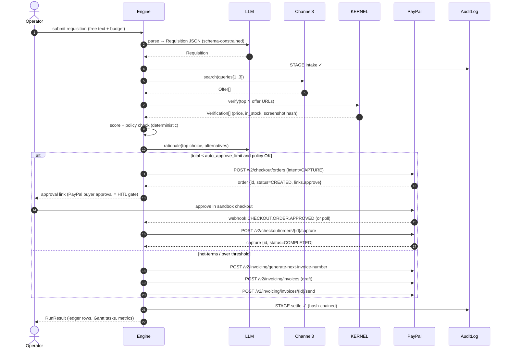

# PayPal Agentic Commerce Studio: Architecture & Implementation Design Specification

**Document:** `DESIGN_OPUS55.md`
**Project:** PayPal Agentic Commerce Studio, a Multi-Sponsor Autonomous Procurement & Settlement Engine
**Python package:** `paypal_agent_studio`
**Author:** Kazutoshi Hayashi (`cal29292929`)
**License:** MIT
**Hackathon:** PayPal AI Hackathon ([paypalaihackathon.devpost.com](https://paypalaihackathon.devpost.com/))
**Submission deadline:** Nov 12, 2026 @ 12:00 PM PST = **Nov 13, 2026 @ 05:00 JST** = Nov 12, 2026 @ 20:00 UTC
**Status:** Design baseline v1.0 (2026-10-27). 16 days remain before the deadline.

---

## Table of Contents

1. [Executive Summary & Judging Alignment](#1-executive-summary--judging-alignment)
2. [System Architecture & Data Flow](#2-system-architecture--data-flow)
3. [Module-by-Module Specification](#3-module-by-module-specification)
4. [Security, Privacy & Reliability](#4-security-privacy--reliability)
5. [Test Strategy](#5-test-strategy)
6. [Deployment, Repository Layout & Submission Assets](#6-deployment-repository-layout--submission-assets)
7. [Delivery Plan to Deadline](#7-delivery-plan-to-deadline)
8. [Risks, Open Items & Verification Checklist](#8-risks-open-items--verification-checklist)
9. [License & Attribution](#9-license--attribution)

---

## 1. Executive Summary & Judging Alignment

### 1.1 Problem

Small businesses, studios and lean operations teams buy constantly. They need equipment, supplies and replacement parts. They do not have a procurement department. Today the buying loop is manual:

1. Search many storefronts.
2. Check whether the price and stock are real.
3. Get approval.
4. Pay.
5. Chase the invoice.
6. Track delivery in a spreadsheet.

Each hand-off loses time and creates audit gaps.

### 1.2 Solution

**Agentic Commerce Studio** turns a plain-language requisition into a settled, auditable purchase. An example requisition: *"Need 6 ergonomic office chairs under $2,400 total, delivered to the Osaka studio by Nov 30."* The pipeline has nine stages:

| # | Stage | What happens | Primary technology |
|---|-------|--------------|--------------------|
| 1 | **Intake** | An LLM parses the requisition into a strict `Requisition` schema (quantity, budget, deadline, constraints). | LLM (Nebius AI Studio, OpenAI-compatible) |
| 2 | **Source** | Candidate products are searched across merchants. | Channel3 Product Search |
| 3 | **Verify** | A cloud browser opens each top candidate's product page and confirms live price and availability. | KERNEL Browser Automation |
| 4 | **Decide** | A deterministic policy engine scores candidates (price, verification confidence, delivery fit, risk) and the LLM writes a human-readable rationale. | `engine.py` + LLM |
| 5 | **Approve** | A human-in-the-loop gate applies above a configurable spend threshold. PayPal buyer approval of the order *is* this gate. | PayPal Orders v2 approval link |
| 6 | **Settle** | An order is created and captured (immediate purchase), or an invoice is drafted and sent (net-terms / supplier billing). | PayPal Orders v2 + Invoicing v2 (via APIMatic-generated SDK in live mode) |
| 7 | **Track** | The fulfillment timeline is shown as a dependency-aware Gantt chart. | Bryntum Gantt / Scheduler |
| 8 | **Reconcile** | A financial ledger grid shows budget versus actual, savings, status and capture IDs. | AG Grid |
| 9 | **Audit & Notify** | A hash-chained audit trail is written. Events can optionally be indexed in Elastic and fanned out through Zapier. | Elastic, Zapier |

The whole platform is also exposed as an **MCP server**, so external AI agents (Claude, IDE assistants, other agents) can call `search_products`, `verify_offer`, `create_purchase`, and the other tools directly. This makes it agent-to-merchant infrastructure, not only a UI.

### 1.3 Design Principles

1. **PayPal is the settlement backbone, not a garnish.** Every completed workflow ends in a PayPal Order capture or a PayPal Invoice, and both carry traceable IDs.
2. **The AI acts, but within guardrails.** Budget caps, per-transaction limits, a merchant allow-list and a human approval threshold are enforced in code. Prompts are not trusted to enforce them.
3. **Zero friction for judges.** `python -m paypal_agent_studio.cli demo` runs the full nine-stage flow in simulation mode in under 5 seconds. It needs only the Python 3.11+ standard library, with no keys and no network.
4. **Live mode is real.** When credentials are present, the same code paths call the real sandbox APIs.
5. **Determinism.** Simulation output is a pure function of `(input, seed)`. Byte-identical artifacts make CI snapshot tests possible.

### 1.4 Judging Criteria Mapping

The official criteria are **Technological Implementation, Design, Potential Impact, Innovation/Idea, and Presentation**. "Quality of Idea" in the brief corresponds to the official *Innovation/Idea* criterion. *Presentation* is included because it is scored.

| Criterion | Official question (abridged) | Concrete features that answer it |
|-----------|------------------------------|-----------------------------------|
| **Technological Implementation** | Thorough, skillful use of PayPal and AI; non-trivial and working | Full Orders v2 lifecycle (create → approve → capture) and Invoicing v2 lifecycle (generate number → draft → send → status). OAuth2 token caching. `PayPal-Request-Id` idempotency. Webhook signature verification. Retries with jittered backoff. A multi-step agent with tool calling. An MCP JSON-RPC 2.0 server. A 60+ test `unittest` suite. A dual live/sim provider layer. |
| **Design** | Complete, coherent product experience | A single-page dashboard with a Requisition composer, an Agent Run timeline (streamed stage events), an AG Grid ledger, a Bryntum fulfillment Gantt, an approval modal that deep-links to PayPal, and an audit drawer. One visual language and one data model throughout. |
| **Potential Impact** | Credible case for a real audience | Target users are SMB operators and studio managers with no procurement staff. The system reports measured outcomes per run: cycle time (requisition → capture), savings versus median list price, the verification catch rate (stale price or out-of-stock detected before payment), and policy-violation blocks. |
| **Innovation/Idea** | Novel, different from existing concepts | Product search, browser verification and payment are usually separate products. Here they are fused into one auditable loop: *verify-before-pay* with a cloud browser, a tamper-evident hash-chained audit trail of every agent decision, and an MCP surface that lets *other* agents buy safely through the same guardrails. |
| **Presentation** | Video shows end-to-end working; clear pitch | A scripted 2:45 demo (§6.4). A hosted Render URL. A deterministic sim mode guarantees the demo cannot break on camera. A live-mode segment shows real sandbox order IDs. |

### 1.5 Prize Track Mapping

Amounts are taken from the official prize list as of 2026-10-27. The brief mentions "Best Overall ($20,000)". The official list has no single $20,000 award. The top placements are **1st $12,000 / 2nd $8,000 / 3rd $5,000**, and the overall-style specials are **$5,000 each**. KERNEL, Elastic, Postman, Zapier and Astropods appear as sponsors but show **no dedicated prize** on the published list. They are integrated where they add genuine value, not to chase awards.

| Track | Published prize | How this project competes |
|-------|-----------------|---------------------------|
| 1st / 2nd / 3rd Place | $12,000 / $8,000 / $5,000 | The overall product quality across all five criteria. |
| Best Use of PayPal + AI | $5,000 | The LLM agent drives real Orders v2 and Invoicing v2 operations under policy guardrails. |
| **Best Use of Agentic Commerce** | $5,000 | **Primary target.** The agent searches, verifies, decides, and transacts. An MCP server enables agent-to-merchant commerce. |
| Most Impactful | $5,000 | Measured SMB procurement outcomes (§1.4). |
| Most Creative | $5,000 | The verify-before-pay cloud-browser loop and the hash-chained agent audit. |
| Best Demo Delivery | $5,000 | The deterministic demo mode and the scripted video. |
| Best Use of AG Grid (1st/2nd/3rd) | $5,000 / $2,000 / $1,000 (×3) | The ledger grid uses grouping by requisition, aggregation (sum and avg), cell renderers for status chips, live row updates during agent runs, CSV export and pinned budget-totals rows. |
| Best Use of APIMatic | $1,000 (×3) + 6 mo. subscription | The APIMatic Context Plugin is used during development for grounded PayPal API context. An optional live adapter uses the APIMatic-generated PayPal Python SDK. Both are documented in the README "Tools" section. |
| Best Use of Bryntum | $1,000 (×3) | The fulfillment Gantt shows dependencies (order → capture → ship → deliver), deadline markers, critical-path highlighting and drag-to-reschedule with a policy re-check. |
| Best Use of Channel3 | $1,500 | Channel3 is the primary sourcing engine. Multi-query fan-out, price normalization and merchant de-duplication are built on it. |
| Best Use of Render (1st/2nd/3rd) | $1,000 / $750 / $500 credits | One-click `render.yaml` Blueprint, a health check, the env-group secret model and a sim-mode default so the hosted demo always works. |
| KERNEL | sponsor (no listed prize) | Cloud-browser verification stage. |
| Elastic | sponsor (no listed prize) | An optional audit/telemetry sink with an ES|QL query panel. |
| Postman | sponsor (no listed prize) | An exported Postman collection and environment for the REST API and MCP-over-HTTP. |
| Zapier | sponsor (no listed prize) | An optional outbound webhook to a Zapier Catch Hook on `settlement.captured` and `invoice.sent`. |
| Astropods | sponsor (no listed prize) | **Not integrated in v1.** It is reserved pending a concrete fit after reviewing the sponsor page (§8). |

**Sponsor credit codes:**
- Channel3: `PAYPAL-HACKATHON-2026`
- KERNEL: `KERNELDEVPOST2026`

Redeem these in each sponsor's dashboard. They are setup instructions only and are never stored in the repository's config files.

---

## 2. System Architecture & Data Flow

### 2.1 Component Diagram

```mermaid
flowchart LR
    subgraph Clients
        UI[Web Dashboard SPA<br/>AG Grid + Bryntum]
        CLI[cli.py]
        EXT[External AI Agent<br/>Claude / IDE / other]
    end

    subgraph paypal_agent_studio
        SRV[server.py<br/>HTTP + REST + SSE]
        MCP[mcp_server.py<br/>JSON-RPC 2.0<br/>stdio + HTTP]
        ENG[engine.py<br/>Orchestrator · Policy · Metrics · Audit]
        MOD[models.py<br/>dataclasses + validation]
        PRV[providers.py<br/>ProviderRegistry]
    end

    subgraph Providers [providers.py: Live | Sim pairs]
        LLM[LLMProvider<br/>Nebius OpenAI-compatible]
        C3[Channel3Provider]
        KB[KernelBrowserProvider]
        PP[PayPalProvider<br/>Orders v2 · Invoicing v2 · OAuth2 · Webhooks]
        TV[ResearchProvider<br/>Tavily, optional]
        SINK[EventSinks<br/>Elastic · Zapier · File]
    end

    UI -->|REST/SSE| SRV
    CLI --> ENG
    EXT -->|MCP| MCP
    SRV --> ENG
    MCP --> ENG
    ENG --> MOD
    ENG --> PRV
    PRV --> LLM & C3 & KB & PP & TV & SINK

    PP -.->|sandbox| PPAPI[(api-m.sandbox.paypal.com)]
    C3 -.-> C3API[(Channel3 API)]
    KB -.-> KAPI[(KERNEL cloud browsers)]
    LLM -.-> NAPI[(Nebius AI Studio)]
    SINK -.-> ES[(Elastic Cloud)] & ZAP[(Zapier Catch Hook)]
```

ASCII fallback for terminals:

```
 ┌──────────┐  ┌──────┐  ┌──────────────┐
 │ Web SPA  │  │ CLI  │  │ External AI  │
 └────┬─────┘  └──┬───┘  └──────┬───────┘
      │REST/SSE   │             │ MCP (stdio | POST /mcp)
 ┌────▼─────┐     │      ┌──────▼──────┐
 │server.py │     │      │mcp_server.py│
 └────┬─────┘     │      └──────┬──────┘
      └───────────┼─────────────┘
            ┌─────▼──────┐   ┌───────────┐
            │ engine.py  │──▶│ models.py │
            └─────┬──────┘   └───────────┘
            ┌─────▼────────────────────────────────────┐
            │ providers.py  (Live ⇄ Sim per provider)  │
            │ LLM · Channel3 · KERNEL · PayPal · Sinks │
            └──────────────────────────────────────────┘
```

### 2.2 Agentic Workflow: Sequence



**Important constraint (by design, not by accident).** Orders v2 with `intent=CAPTURE` requires payer approval before capture. The agent therefore **cannot** spend money without a human clicking approve in PayPal. This is the primary safety gate. In simulation mode, approval is simulated by an explicit `approve` call (UI button, CLI flag `--auto-approve-sim`, or the MCP tool `approve_order_sim`). Approval is never implicit.

### 2.3 Run State Machine

```
DRAFT → PARSED → SOURCED → VERIFIED → DECIDED ─┬─▶ AWAITING_APPROVAL → APPROVED → CAPTURED → FULFILLING → CLOSED
                                               ├─▶ INVOICED (SENT) → PAID → FULFILLING → CLOSED
                                               └─▶ BLOCKED (policy)          any → FAILED (with error code)
```

Transitions are validated in `engine.py` against an explicit `ALLOWED_TRANSITIONS` table. An illegal transition raises `StateTransitionError`.

### 2.4 Dual-Mode Execution

| Aspect | (A) Live mode | (B) Simulation mode (default) |
|--------|---------------|-------------------------------|
| Trigger | `STUDIO_MODE=live` **and** the required keys for that provider are present | Default, or any provider whose keys are missing |
| Granularity | **Per provider.** For example, PayPal can be live while Channel3 is simulated. | Per provider |
| Network | HTTPS via `urllib.request` | None. `socket` is never opened (enforced in tests) |
| Latency | Real | Run in under 5 s for the full demo (target under 1.5 s) |
| Output | Real sandbox IDs (e.g., `5O190127TN364715T`) | Realistic, deterministic IDs derived from `sha256(seed‖input)` in PayPal's ID format |
| Telemetry | Real HTTP status, `paypal-debug-id`, latency | Synthetic telemetry from a seeded distribution: latency log-normal (μ by provider), 2% retryable 5xx injected only when `STUDIO_SIM_FAULTS=1` |
| Visibility | Mode badge `LIVE · sandbox` | Mode badge `SIMULATION` on every UI view, artifact and MCP response (`"mode": "sim"`) |

Simulation is never presented as live. Each `ProviderResult` carries a `mode` field and the UI renders it.

#### 2.4.1 Environment Variables (`.env`)

| Variable | Required for | Notes |
|----------|--------------|-------|
| `STUDIO_MODE` | all | `sim` (default) or `live` |
| `STUDIO_SEED` | sim | Integer, default `20261112` |
| `PAYPAL_CLIENT_ID`, `PAYPAL_CLIENT_SECRET` | PayPal live | Sandbox app credentials only |
| `PAYPAL_BASE_URL` | PayPal live | Default `https://api-m.sandbox.paypal.com`. Non-sandbox hosts are **rejected** (§4.1). |
| `PAYPAL_WEBHOOK_ID` | webhook verification | From the sandbox app's webhook config |
| `NEBIUS_API_KEY` | LLM live | OpenAI-compatible endpoint |
| `NEBIUS_BASE_URL`, `NEBIUS_MODEL` | LLM live | Configurable, so no model name is hard-coded |
| `CHANNEL3_API_KEY` | Channel3 live | |
| `KERNEL_API_KEY` | KERNEL live | |
| `TAVILY_API_KEY` | optional research | Supplier background lookup for the risk score |
| `ELASTIC_URL`, `ELASTIC_API_KEY` | optional sink | |
| `ZAPIER_HOOK_URL` | optional sink | Must be `https://hooks.zapier.com/...` |
| `STUDIO_AUTO_APPROVE_LIMIT` | policy | Default `500.00`. Above this, invoice mode is forced or the run is blocked. |
| `STUDIO_MAX_RUN_BUDGET` | policy | Hard cap, default `5000.00` |

`YOUCAM_API_KEY` appears in the shared hackathon template but has **no role** in this project. It is not read, and `.env.example` omits it.

### 2.5 External API Schemas

All live calls go through `providers._http()` (§3.3). PayPal schemas follow the public REST reference. Channel3 and KERNEL endpoint paths are **configuration constants**, because those APIs version independently. They must be verified against current sponsor docs before live testing (§8).

#### 2.5.1 PayPal OAuth2

```http
POST /v1/oauth2/token
Authorization: Basic base64(client_id:client_secret)
Content-Type: application/x-www-form-urlencoded

grant_type=client_credentials
```

```json
{ "access_token": "A21AA...", "token_type": "Bearer", "expires_in": 32400, "app_id": "APP-80W..." }
```

The token is cached in memory until `expires_in - 60s`. It is never logged and never written to disk.

#### 2.5.2 Orders v2: Create

```http
POST /v2/checkout/orders
Authorization: Bearer <token>
Content-Type: application/json
PayPal-Request-Id: run_<run_id>_create          # idempotency
Prefer: return=representation
```

```json
{
  "intent": "CAPTURE",
  "purchase_units": [{
    "reference_id": "REQ-7F3A2C",
    "description": "6x Ergonomic Mesh Chair (agent-sourced)",
    "custom_id": "run_01JC9K...",
    "amount": {
      "currency_code": "USD",
      "value": "2148.00",
      "breakdown": { "item_total": { "currency_code": "USD", "value": "2148.00" } }
    },
    "items": [{
      "name": "Ergonomic Mesh Chair",
      "quantity": "6",
      "unit_amount": { "currency_code": "USD", "value": "358.00" },
      "category": "PHYSICAL_GOODS",
      "sku": "C3-8812AB"
    }]
  }],
  "payment_source": {
    "paypal": {
      "experience_context": {
        "user_action": "PAY_NOW",
        "shipping_preference": "NO_SHIPPING",
        "return_url": "https://<host>/approve/return?run=run_01JC9K...",
        "cancel_url": "https://<host>/approve/cancel?run=run_01JC9K..."
      }
    }
  }
}
```

Response (abridged):

```json
{
  "id": "5O190127TN364715T",
  "status": "PAYER_ACTION_REQUIRED",
  "links": [
    { "rel": "self",          "href": ".../v2/checkout/orders/5O190127TN364715T", "method": "GET" },
    { "rel": "payer-action",  "href": "https://www.sandbox.paypal.com/checkoutnow?token=5O190127TN364715T", "method": "GET" }
  ]
}
```

`items[].sku` is truncated to the PayPal max length. Money is always handled as `Decimal` and serialized with two-decimal precision for USD. Currency exponent tables cover zero-decimal currencies such as JPY.

#### 2.5.3 Orders v2: Capture

```http
POST /v2/checkout/orders/{id}/capture
PayPal-Request-Id: run_<run_id>_capture
```

```json
{
  "id": "5O190127TN364715T",
  "status": "COMPLETED",
  "purchase_units": [{ "payments": { "captures": [{
      "id": "3C679366HH908993F", "status": "COMPLETED",
      "amount": { "currency_code": "USD", "value": "2148.00" } }] } }]
}
```

Error handling: `422 UNPROCESSABLE_ENTITY` with issue `ORDER_NOT_APPROVED` maps to `ApprovalPendingError`, and the run stays in `AWAITING_APPROVAL`. `INSTRUMENT_DECLINED` maps to `FAILED`, with a retry-with-new-approval suggestion.

#### 2.5.4 Invoicing v2

```http
POST /v2/invoicing/generate-next-invoice-number         → { "invoice_number": "0042" }
POST /v2/invoicing/invoices                             → 201 { "href": ".../invoices/INV2-XXXX-..." }
POST /v2/invoicing/invoices/{invoice_id}/send           → 200/202
GET  /v2/invoicing/invoices/{invoice_id}                → { "status": "SENT" | "PAID" | ... }
```

Draft body (abridged):

```json
{
  "detail": {
    "invoice_number": "0042",
    "currency_code": "USD",
    "note": "Agent-generated procurement invoice for REQ-7F3A2C",
    "payment_term": { "term_type": "NET_30" }
  },
  "invoicer": { "name": { "given_name": "Studio", "surname": "Ops" } },
  "primary_recipients": [{ "billing_info": { "email_address": "<sandbox-buyer>@personal.example.com" } }],
  "items": [{ "name": "Ergonomic Mesh Chair", "quantity": "6",
              "unit_amount": { "currency_code": "USD", "value": "358.00" },
              "unit_of_measure": "QUANTITY" }]
}
```

The recipient email must be a **sandbox buyer account**. The provider rejects any recipient address that is not listed in `PAYPAL_SANDBOX_RECIPIENTS` (an allow-list), so a real person is never invoiced.

#### 2.5.5 Webhook Verification

```http
POST /v1/notifications/verify-webhook-signature
{ "auth_algo": "...", "cert_url": "...", "transmission_id": "...", "transmission_sig": "...",
  "transmission_time": "...", "webhook_id": "<PAYPAL_WEBHOOK_ID>", "webhook_event": { ... } }
→ { "verification_status": "SUCCESS" }
```

Unverified webhooks get a `400` response and are audited as `webhook.rejected`. Handled events:
- `CHECKOUT.ORDER.APPROVED`
- `PAYMENT.CAPTURE.COMPLETED`
- `PAYMENT.CAPTURE.DENIED`
- `INVOICING.INVOICE.PAID`

If the deployment cannot receive webhooks (local dev), the engine **polls** `GET /v2/checkout/orders/{id}` with backoff, up to 10 minutes.

#### 2.5.6 Channel3 Product Search (live adapter)

Normalized internal contract. The provider maps the vendor response into it.

```json
// request (internal)
{ "query": "ergonomic mesh office chair", "max_price": 400.00, "currency": "USD", "limit": 10 }
// response (internal, normalized)
{ "offers": [{
    "offer_id": "c3_8812ab", "title": "Ergonomic Mesh Chair", "merchant": "example-store",
    "url": "https://example-store.test/p/8812ab", "price": "358.00", "currency": "USD",
    "image_url": "https://...", "availability": "in_stock", "source": "channel3" }] }
```

`CHANNEL3_BASE_URL` and `CHANNEL3_SEARCH_PATH` are constants in `providers.py`. The mapping function `_normalize_channel3()` is unit-tested against recorded fixture JSON.

#### 2.5.7 KERNEL Browser Verification (live adapter)

1. Create a cloud browser session via the KERNEL REST API. This returns a session ID and a CDP WebSocket URL.
2. If the optional `playwright` extra is installed, connect over CDP, navigate to `offer.url`, and extract the price using a JSON-LD `Offer` → OpenGraph → regex cascade, plus availability.
3. Close the session in `finally`.

```json
{ "offer_id": "c3_8812ab", "verified": true, "observed_price": "358.00",
  "price_delta_pct": 0.0, "in_stock": true, "confidence": 0.93,
  "evidence": { "method": "jsonld", "page_sha256": "9f2c...", "screenshot_sha256": "a71e..." } }
```

If `playwright` is not installed, the live KERNEL provider degrades to sim, with a logged warning and `mode: "sim"` on the result. The core stays zero-dependency.

#### 2.5.8 LLM (Nebius AI Studio, OpenAI-compatible)

`POST {NEBIUS_BASE_URL}/chat/completions` is called with `response_format: {"type":"json_object"}` and a system prompt that embeds the target JSON schema. Every LLM output is **re-validated** by `models.Requisition.from_dict()`. If validation fails, the call is retried once with the validation error appended. A second failure falls back to the deterministic rule-based parser (`engine._heuristic_parse`). The LLM **never** produces amounts that reach PayPal directly. Amounts always come from verified offer prices multiplied by quantity in `Decimal`.

### 2.6 Internal REST API (`server.py`)

| Method | Path | Body / Query | Response |
|--------|------|--------------|----------|
| GET | `/` | none | SPA HTML |
| GET | `/healthz` | none | `{"status":"ok","mode":{"paypal":"sim",...},"version":"1.0.0"}` |
| POST | `/api/runs` | `{"requisition_text": str, "budget": "2400.00", "currency":"USD", "deadline":"2026-11-30", "settlement":"order"\|"invoice"}` | `201 RunResult` (state ≥ DECIDED or AWAITING_APPROVAL) |
| GET | `/api/runs` | `?limit=50` | `RunSummary[]` |
| GET | `/api/runs/{run_id}` | none | `RunResult` |
| GET | `/api/runs/{run_id}/events` | none | `text/event-stream` stage events |
| POST | `/api/runs/{run_id}/approve` | sim: `{}`; live: none (returns `approve_url`) | `RunResult` |
| POST | `/api/runs/{run_id}/capture` | none | `RunResult` |
| GET | `/api/runs/{run_id}/ledger` | none | AG Grid `rowData[]` |
| GET | `/api/runs/{run_id}/timeline` | none | Bryntum `{tasks, dependencies}` |
| GET | `/api/runs/{run_id}/audit` | none | `AuditEntry[]` + `chain_valid: bool` |
| POST | `/webhooks/paypal` | PayPal event | `200` / `400` |
| POST | `/mcp` | JSON-RPC 2.0 | MCP Streamable-HTTP (§3.5) |
| GET | `/approve/return` | `?run=&token=` | Redirect to SPA with state refresh |

Error envelope (all non-2xx):

```json
{ "error": { "code": "VALIDATION_ERROR", "message": "budget must be > 0", "field": "budget", "request_id": "req_..." } }
```

---

## 3. Module-by-Module Specification

General conventions:
- Python ≥ 3.11, standard library only for the core.
- Optional extras: `playwright` (KERNEL live) and `paypal-server-sdk` (the APIMatic-generated PayPal SDK, live adapter).
- `from __future__ import annotations`.
- Full type hints.
- `Decimal` for money, timezone-aware UTC `datetime`.
- No global mutable state except the explicit `ProviderRegistry` and in-memory `RunStore`, both injectable for tests.

### 3.1 `paypal_agent_studio/__init__.py`

```python
"""PayPal Agentic Commerce Studio: autonomous procurement & settlement engine."""
__version__ = "1.0.0"
__author__ = "Kazutoshi Hayashi"
__license__ = "MIT"

from .models import Requisition, Offer, Verification, Decision, Settlement, RunResult
from .engine import Engine, EngineConfig
from .providers import ProviderRegistry, build_registry

__all__ = ["Engine", "EngineConfig", "ProviderRegistry", "build_registry",
           "Requisition", "Offer", "Verification", "Decision", "Settlement", "RunResult",
           "__version__"]
```

There are no side effects on import: no `.env` reading and no network.

### 3.2 `paypal_agent_studio/models.py`

**Responsibilities:** immutable domain types, strict validation, and stable JSON serialization.

```python
class ValidationError(ValueError):
    def __init__(self, field: str, message: str): ...

Money = Decimal  # always quantized via quantize_money(value, currency)

@dataclass(frozen=True, slots=True)
class Requisition:
    item_query: str            # 3..200 chars, control chars stripped
    quantity: int              # 1..1000
    budget_total: Decimal      # > 0, ≤ STUDIO_MAX_RUN_BUDGET
    currency: str              # ISO-4217, allow-list {"USD","EUR","GBP","JPY","AUD","CAD"}
    deadline: date | None      # ≥ today (injected clock)
    constraints: tuple[str, ...] = ()   # ≤ 10, each ≤ 80 chars
    settlement: Literal["order", "invoice"] = "order"

    @classmethod
    def from_dict(cls, d: Mapping[str, Any]) -> "Requisition": ...  # rejects unknown keys
    def to_dict(self) -> dict[str, Any]: ...

@dataclass(frozen=True, slots=True)
class Offer:            offer_id, title, merchant, url (https only), unit_price, currency, availability, source
@dataclass(frozen=True, slots=True)
class Verification:     offer_id, verified, observed_price, price_delta_pct, in_stock, confidence (0..1), evidence
@dataclass(frozen=True, slots=True)
class ScoredOffer:      offer, verification, score (0..100), components: dict[str, float], violations: tuple[str, ...]
@dataclass(frozen=True, slots=True)
class Decision:         chosen: ScoredOffer | None, alternatives: tuple[ScoredOffer, ...], rationale: str, policy_outcome
@dataclass(frozen=True, slots=True)
class Settlement:       kind ("order"|"invoice"), paypal_id, status, amount, currency, approve_url, capture_id, invoice_number
@dataclass(frozen=True, slots=True)
class AuditEntry:       seq, ts, run_id, stage, event, payload_digest, prev_hash, hash
@dataclass(slots=True)
class RunResult:        run_id, state, mode_map, requisition, offers, verifications, decision,
                        settlement, metrics, timeline, ledger, audit, errors
```

**Rules:**
- `from_dict` is the **only** constructor used at trust boundaries (HTTP, MCP, LLM output). It rejects unknown keys, coerces numeric strings to `Decimal` (floats are rejected, to avoid binary rounding), and enforces bounds.
- `to_dict()` emits money as strings and dates as ISO-8601. Keys are sorted on `json.dumps(..., sort_keys=True)` for deterministic artifacts.
- `run_id` uses the format `run_<26-char ULID>`. In sim mode the ULID is derived from the seed and input, so it is deterministic.
- `AuditEntry.hash = sha256(prev_hash ‖ canonical_json(entry_without_hash))`. The genesis `prev_hash` is 64 zeros.

### 3.3 `paypal_agent_studio/providers.py`

**Responsibilities:** all I/O to external services. Each provider type is a `Protocol` with `Live*` and `Sim*` implementations. `build_registry(env)` selects one per provider.

```python
class LLMProvider(Protocol):
    def complete_json(self, system: str, user: str, schema_hint: dict) -> ProviderResult[dict]: ...
class ProductSearchProvider(Protocol):
    def search(self, query: str, *, max_price: Decimal | None, currency: str, limit: int) -> ProviderResult[list[Offer]]: ...
class BrowserVerifyProvider(Protocol):
    def verify(self, offer: Offer) -> ProviderResult[Verification]: ...
class PaymentsProvider(Protocol):
    def create_order(self, run_id: str, req: Requisition, offer: Offer, qty: int) -> ProviderResult[Settlement]: ...
    def get_order(self, order_id: str) -> ProviderResult[Settlement]: ...
    def capture_order(self, run_id: str, order_id: str) -> ProviderResult[Settlement]: ...
    def create_and_send_invoice(self, run_id: str, req: Requisition, offer: Offer, qty: int) -> ProviderResult[Settlement]: ...
    def verify_webhook(self, headers: Mapping[str, str], body: bytes) -> bool: ...
class EventSink(Protocol):
    def emit(self, event: dict) -> None: ...   # must never raise; failures are logged

@dataclass(frozen=True)
class ProviderResult(Generic[T]):
    value: T
    mode: Literal["live", "sim"]
    latency_ms: float
    attempts: int
    debug_id: str | None   # e.g. paypal-debug-id header
```

**HTTP core (`_http`):**
- `urllib.request` with an explicit `timeout` (connect+read 10 s default, 30 s for KERNEL session create).
- **Retry policy:** up to 3 attempts on `429`, `500`, `502`, `503`, `504`, and connection/timeout errors. Exponential backoff `base=0.5s × 2^n` with full jitter, capped at 8 s. `Retry-After` is honoured when it is ≤ 30 s. Non-idempotent PayPal POSTs are only retried because they carry `PayPal-Request-Id`. Requests without an idempotency key are never retried on POST.
- **Auth strategies:** `BearerAuth` (PayPal token, Nebius, Channel3, KERNEL) and `BasicAuth` (PayPal token endpoint). `HmacAuth` (HMAC-SHA256 over `ts.body`, header `X-Studio-Signature`) signs **outbound** Zapier/Elastic event payloads, so receivers can verify origin. The same scheme is used to verify **inbound** calls to `/mcp` when `STUDIO_MCP_HMAC_SECRET` is set.
- **TLS:** default `ssl.create_default_context()`. Certificate verification is never disabled.
- Responses larger than 2 MiB are rejected. JSON is parsed with a recursion depth guard.
- **Rate limiting (client side):** a token bucket per provider (PayPal 10 rps, Channel3 5 rps, KERNEL 2 concurrent sessions, LLM 3 rps). All values are configurable.

**Simulation providers:**
- `SimRandom(seed, *namespace)` is built from `hashlib.sha256(f"{seed}|{ns}|{input}")`. It feeds a local `random.Random` instance, never the global RNG.
- `SimChannel3` uses a built-in catalog of ~120 products across 12 procurement categories (office furniture, IT peripherals, networking, packaging, cleaning, studio lighting, and so on) with realistic price bands. Per-query results are a deterministic filtered and perturbed subset. Merchants have fictional `.test` domains.
- `SimKernel` deterministically produces about 80% exact-match, 12% price drift (+3–15%) and 8% out-of-stock. This lets the "verify-before-pay" catch rate show up in demos.
- `SimPayPal` emits IDs in PayPal format (17-char uppercase alphanumeric order IDs, `INV2-XXXX-XXXX-XXXX-XXXX` invoices) and enforces the **same state rules** as the real API: capture before approve yields `ApprovalPendingError`, and a repeated capture with the same request-id returns the same result.
- `SimLLM` is a rule-based parser plus template rationales. Its output is schema-identical to live.

**APIMatic integration:**
- Development time: the APIMatic Context Plugin is configured in the IDE/agent so code generation for the PayPal adapters is grounded in the current PayPal API spec. This usage is documented in the README "Tools" section.
- Runtime: `LivePayPalAPIMaticAdapter` implements `PaymentsProvider` using the APIMatic-generated PayPal Server SDK (`paypal-server-sdk`, optional extra) when `STUDIO_PAYPAL_CLIENT=apimatic`. Otherwise the stdlib `LivePayPal` is used.
- Both adapters pass the **same** contract test suite against `SimPayPal` fixtures.

### 3.4 `paypal_agent_studio/engine.py`

**Responsibilities:** orchestration, policy, scoring, metrics, the audit trail and the state machine.

```python
@dataclass(frozen=True)
class EngineConfig:
    auto_approve_limit: Decimal = Decimal("500.00")
    max_run_budget: Decimal = Decimal("5000.00")
    verify_top_n: int = 3
    max_price_drift_pct: float = 5.0
    merchant_allowlist: frozenset[str] | None = None
    merchant_blocklist: frozenset[str] = frozenset()
    clock: Callable[[], datetime] = utc_now      # injectable for determinism

class Engine:
    def __init__(self, registry: ProviderRegistry, config: EngineConfig, store: RunStore | None = None,
                 sinks: Sequence[EventSink] = ()): ...
    def start_run(self, text: str, *, budget: Decimal, currency: str = "USD",
                  deadline: date | None = None, settlement: str = "order") -> RunResult: ...
    def approve(self, run_id: str) -> RunResult: ...          # sim-only; live returns approve_url
    def capture(self, run_id: str) -> RunResult: ...
    def handle_webhook(self, event: dict) -> RunResult | None: ...
    def get(self, run_id: str) -> RunResult: ...
    def verify_audit_chain(self, run_id: str) -> bool: ...
```

**Scoring (deterministic, documented in the UI):**

| Component | Weight | Formula |
|-----------|--------|---------|
| Price | 0.40 | `1 − (unit_price × qty) / budget_total`, clamped to 0..1 |
| Verification | 0.30 | `confidence × (1 if in_stock else 0) × max(0, 1 − |drift%| / max_drift)` |
| Delivery fit | 0.20 | 1.0 if estimated delivery ≤ deadline; linear decay over 7 days late |
| Merchant risk | 0.10 | `1 − risk` (risk from history plus optional Tavily signal, default 0.2) |

**Hard policy violations** exclude a candidate regardless of score:
- over budget
- over `max_run_budget`
- out of stock
- drift > `max_price_drift_pct`
- blocklisted merchant
- non-allow-listed merchant (when an allow-list is set)
- currency mismatch

**Routing:**
- `total ≤ auto_approve_limit` → order.
- `total > auto_approve_limit` → invoice if the requisition allows it, otherwise `BLOCKED` with reason `REQUIRES_MANAGER_APPROVAL`.

**Metrics** (`RunResult.metrics`):

| Metric | Definition |
|--------|------------|
| `cycle_time_s` | requisition received → capture/invoice sent (clock-injected) |
| `savings_abs`, `savings_pct` | (median verified market price − chosen price) × qty |
| `budget_utilization_pct` | chosen total / budget |
| `verification_catch_count` | candidates excluded by KERNEL evidence (drift / OOS) |
| `policy_blocks` | count, by violation code |
| `provider_latency_ms` | per provider p50/p95 within the run |
| `llm_fallbacks` | count of schema-validation fallbacks |

**Timeline generation (Bryntum):** tasks are `Approve → Capture/Invoice → Merchant processing → Shipping → Delivery`, with finish-to-start dependencies. A deadline constraint is set on Delivery. Durations come from merchant SLA (live: extracted by KERNEL when available; sim: seeded).

**Ledger generation (AG Grid):** one row per candidate. Columns: `requisition, merchant, title, qty, unit_price, total, verified_price, drift_pct, score, status, paypal_id, capture_id`.

**Audit:** every stage emits an `AuditEntry`. Payloads are **digested** with SHA-256, so raw PII and tokens never sit in the audit log (§4.2). `verify_audit_chain` recomputes the chain, and the UI shows a green or red integrity badge.

### 3.5 `paypal_agent_studio/mcp_server.py`

**Responsibilities:** an MCP server over JSON-RPC 2.0.

**Transports:**
1. **stdio:** newline-delimited JSON messages on stdin/stdout. Logs go to stderr only. Launch with `python -m paypal_agent_studio.mcp_server`.
2. **HTTP:** `POST /mcp` mounted in `server.py`, following the Streamable HTTP transport. JSON responses are used for v1 (no server-initiated streams). `Origin` header validation applies, and binding is to `127.0.0.1` unless `STUDIO_HOST` is set.

**Lifecycle:**
- `initialize`: returns `protocolVersion` (negotiated; supports `2025-06-18`), `capabilities: {"tools": {"listChanged": false}}`, and `serverInfo: {"name": "paypal-agent-studio", "version": "1.0.0"}`.
- `notifications/initialized`: no response.
- `ping`.
- `tools/list`.
- `tools/call`.

**Tools (6):**

| Tool | Input schema (JSON Schema, abridged) | Effect |
|------|--------------------------------------|--------|
| `parse_requisition` | `{text: string ≤2000, budget: string, currency?: string}` | Returns a validated `Requisition` |
| `search_products` | `{query: string, max_price?: string, currency?: string, limit?: int 1..20}` | Channel3 search, returns `Offer[]` |
| `verify_offer` | `{offer_id: string, url: string(uri, https)}` | KERNEL verification, returns `Verification` |
| `run_procurement` | `{requisition_text, budget, currency?, deadline?, settlement?}` | The full pipeline up to `AWAITING_APPROVAL` / `INVOICED`, returns `RunResult` with `approve_url` |
| `get_run_status` | `{run_id: string}` | Returns `RunResult` (refreshes PayPal status in live mode) |
| `capture_order` | `{run_id: string}` | Captures **only if** PayPal reports the order `APPROVED`. Never bypasses approval. |

A sim-only tool, `approve_order_sim {run_id}`, is listed **only** when the PayPal provider is in sim mode.

**Errors:**
- Standard JSON-RPC codes: `-32700` parse, `-32600` invalid request, `-32601` method not found, `-32602` invalid params.
- Tool execution failures return `result.isError: true` with a text content block, following MCP convention. They do not return a protocol error.
- Each `tools/call` result includes `structuredContent` (the JSON object) plus a `text` content block summary.

**Guardrails for agent callers:**
- The same `EngineConfig` policy applies.
- A per-session spend counter is capped at `STUDIO_MCP_SESSION_BUDGET` (default `1000.00`).
- Tool descriptions state explicitly that payment requires human approval in PayPal.

### 3.6 `paypal_agent_studio/server.py`

**Responsibilities:** a zero-dependency HTTP server (`http.server.ThreadingHTTPServer`), the REST API (§2.6), SSE, the MCP mount and the SPA.

**Server:**
- Routing is a small regex dispatch table. Request size limit is 256 KiB. JSON content-type is enforced on POST.
- Security headers: `Content-Security-Policy` (scripts from self plus pinned CDN hosts for AG Grid/Bryntum with SRI hashes), `X-Content-Type-Options: nosniff`, `Referrer-Policy: no-referrer`, `X-Frame-Options: DENY`.
- `PORT` comes from env (Render injects it). Bind is `0.0.0.0` when `RENDER=true`, otherwise `127.0.0.1`.
- Graceful shutdown on SIGTERM.

**SPA** (an embedded HTML string, or `paypal_agent_studio/static/index.html` served from package data). Layout:

```
┌───────────────────────────────────────────────────────────────────────┐
│ Agentic Commerce Studio   [MODE: SIMULATION]   Audit chain: ✔ valid  │
├──────────────────────┬────────────────────────────────────────────────┤
│ Requisition composer │  Agent Run stream (stage cards, live via SSE)  │
│  text · budget · date│  Intake ✔  Source ✔  Verify ⚠ 1 drift caught   │
│  [Run agent]         │  Decide ✔  → [Approve in PayPal]               │
├──────────────────────┴────────────────────────────────────────────────┤
│ AG Grid ledger: grouped by requisition, totals pinned, status chips   │
├───────────────────────────────────────────────────────────────────────┤
│ Bryntum Gantt: approve → capture → ship → deliver, deadline line      │
└───────────────────────────────────────────────────────────────────────┘
```

**AG Grid:**
- Community edition from a pinned CDN version.
- Features: `rowGroup` on requisition, `aggFunc: 'sum'` on totals, value formatters for currency, custom cell renderers for status and drift, `applyTransaction` for live updates from SSE, quick filter, and CSV export.
- Enterprise-only features (pivoting, integrated charts) are used **only** if a trial/hackathon key is provided via `AG_GRID_LICENSE_KEY`. Otherwise they are hidden, not watermark-broken.

**Bryntum:**
- Gantt (or Scheduler Pro) loaded from the trial or hackathon-licensed distribution.
- Features: task dependencies, a deadline `timeRanges` marker, critical-path highlighting, and drag-to-reschedule. A drag calls `PATCH`-style `POST /api/runs/{id}/timeline` and re-runs the delivery-fit policy check.
- If the Bryntum assets fail to load (offline judge), the SPA falls back to a minimal SVG timeline renderer, so the experience never dead-ends.

**Accessibility:** semantic landmarks, keyboard-navigable composer and approve flow, `aria-live` on the run stream, and WCAG AA contrast.

### 3.7 `paypal_agent_studio/cli.py`

```
python -m paypal_agent_studio.cli demo   [--seed 20261112] [--out artifacts/] [--auto-approve-sim]
python -m paypal_agent_studio.cli run    --text "..." --budget 2400 [--currency USD] [--deadline 2026-11-30] [--settlement order|invoice]
python -m paypal_agent_studio.cli status --run-id run_...
python -m paypal_agent_studio.cli serve  [--port 8000]
python -m paypal_agent_studio.cli verify-audit artifacts/run_*.json
```

The `demo` command runs **three canned scenarios**:
1. A happy path order.
2. A price-drift catch (KERNEL rejects the cheapest offer).
3. An over-threshold requisition routed to an invoice.

Artifacts written:
- `artifacts/run_<id>.json`: the full `RunResult`, sorted keys.
- `artifacts/run_<id>.md`: a human-readable report with stage table, decision rationale, metrics and audit hashes.
- `artifacts/summary.md`: a cross-scenario metrics table.

Exit codes: `0` success, `2` validation error, `3` policy block (in `run`), `4` provider failure.

### 3.8 `tests/`

See §5. The layout is:

```
tests/
  __init__.py
  fixtures/                 # recorded, scrubbed JSON for PayPal, Channel3 & KERNEL normalizers
  test_models.py
  test_providers.py
  test_engine.py
  test_security.py
  test_mcp_server.py
  test_http_api.py
  test_cli.py
  test_determinism.py
```

---

## 4. Security, Privacy & Reliability

### 4.1 Credential Isolation

- **Loading.** Secrets are read **only** in `providers.build_registry()` from `os.environ`. A tiny stdlib `.env` loader (`providers.load_dotenv(path)`) runs only when invoked from `cli.py` or `server.py` entrypoints. It never runs on import.
- **Storage.** Secrets live in a `SecretStr` wrapper whose `__repr__` and `__str__` return `"***"`. Secret values are never placed in `RunResult`, artifacts, audit entries, logs or MCP responses. Tests assert this by scanning all outputs for the secret values.
- **Repository hygiene.** `.env` is in `.gitignore`. `.env.example` ships with empty values. A pre-commit check (a `scripts/check_secrets.py` regex for `A21AA`, `sk-`, and similar prefixes) runs in CI.
- **Sandbox lock.** `PAYPAL_BASE_URL` must match `^https://api-m\.sandbox\.paypal\.com$`. Anything else raises `ConfigError` at startup. Moving to production would be a deliberate, separate code change that is out of scope for the hackathon.
- **Render.** Secrets are stored in a Render Environment Group, not in `render.yaml`.

### 4.2 Input Validation & Privacy

- Every trust boundary (HTTP JSON, MCP params, LLM output, webhook payloads, vendor responses) goes through `models.*.from_dict`. Unknown fields are rejected.
- **URL safety (SSRF defence for KERNEL).**
  - `https` scheme only.
  - Hostnames that resolve to private, loopback or link-local ranges, or to metadata IPs, are rejected.
  - Navigation runs in KERNEL's remote browser, never on the server host.
- **Prompt-injection containment.**
  - Scraped page text is never fed back as instructions. Only extracted, typed fields (price, stock) reach the engine.
  - The LLM has no tool that can move money. Payment calls are made only by deterministic engine code after policy checks.
- **Zero PII retention.**
  - Requisition text is stored in memory for the run lifetime only (TTL 24 h in `RunStore`, configurable).
  - Payer details returned by PayPal (name, email, address) are **dropped at the provider boundary**. Only IDs, statuses and amounts are kept.
  - Audit entries store payload digests, not payloads.
  - Artifacts contain no payer data.
  - Logs carry request IDs, not bodies.
- **Output encoding.** The SPA renders all dynamic values via `textContent` or grid value formatters, never `innerHTML`.

### 4.3 Rate Limits & Resilience

| Concern | Mechanism |
|---------|-----------|
| Upstream 429 | Honour `Retry-After` (≤ 30 s). Otherwise jittered backoff, plus a client-side token bucket. |
| Transient 5xx / timeouts | ≤ 3 attempts with backoff, only on idempotent or idempotency-keyed calls |
| Duplicate payment | `PayPal-Request-Id` per `(run_id, operation)`, plus engine state checks (capture only from `APPROVED`) |
| Provider outage | Per-provider circuit breaker: 5 consecutive failures open it for 60 s. The run continues with the sim provider only in the **non-payment** stages, clearly flagged. A PayPal outage never falls back to sim mid-run. It fails closed with `FAILED: PAYMENTS_UNAVAILABLE`. |
| Inbound abuse | Per-IP token bucket on `/api/*` and `/mcp` (default 30 req/min), plus 256 KiB body cap |
| Long-running browser | 45 s KERNEL budget per offer. The session is closed in `finally`. |

### 4.4 Deterministic Reproducibility

- Simulation randomness is seeded per namespace and input. The global `random` module is never used. The clock is injected (`EngineConfig.clock`), and sim runs use a fixed epoch.
- JSON artifacts use `sort_keys=True`, `separators=(",", ":")` for hashing and `indent=2` for files.
- `test_determinism.py` runs the demo twice and asserts byte-identical artifacts and identical audit-chain head hashes.

### 4.5 Threat Model Summary

| Threat | Mitigation |
|--------|------------|
| An agent overspends via MCP | Policy caps, session budget, mandatory PayPal payer approval |
| Malicious product page injects instructions | Typed extraction only; the LLM is never given payment tools |
| Forged webhook marks an order paid | PayPal signature verification, plus re-fetching order state before acting |
| Secret leakage via logs or artifacts | `SecretStr`, an output-scanning test, digest-only audit |
| Tampering with the audit history | SHA-256 hash chain plus integrity badge and CLI verifier |
| SSRF through user-supplied URLs | Scheme and IP-range validation; remote-browser execution |

---

## 5. Test Strategy

**Framework and runtime:**
- `unittest` only: `python -m unittest discover -s tests -v`.
- Target: the full suite runs in under 10 s, and the demo path in under 5 s.
- All tests run in sim mode with network access disabled. `tests/__init__.py` patches `socket.socket.connect` to raise during the test session. Live-mode tests are opt-in via `STUDIO_LIVE_TESTS=1` and skipped otherwise.

| File | Key cases (minimum) |
|------|---------------------|
| `test_models.py` | Valid round-trip `to_dict`/`from_dict`. Rejects floats for money, unknown keys, negative or zero budget, quantity bounds, bad currency, past deadline, non-https offer URLs. Currency quantization for JPY versus USD. Audit hash computation. |
| `test_providers.py` | Sim determinism per seed. Sim PayPal state rules (capture before approve yields an error; idempotent capture). Channel3/KERNEL normalizers against fixtures. Retry/backoff using a fake transport (429 then 200; 503×3 then failure). `Retry-After` honoured. POST without an idempotency key is not retried. Token caching and expiry. Sandbox URL lock. |
| `test_engine.py` | Happy path reaches `AWAITING_APPROVAL` → `CAPTURED`. A drift catch excludes the cheapest offer. An out-of-stock offer is excluded. Over threshold routes to invoice. Over threshold with no invoice gives `BLOCKED`. All candidates violating gives `BLOCKED` with codes. The illegal state transition raises. Metrics math (savings, utilization). Timeline dependencies are acyclic and respect the deadline. The audit chain validates, and tampering is detected. |
| `test_security.py` | Secrets are absent from all outputs. SSRF URL rejections (127.0.0.1, 169.254.169.254, `file://`, IPv6 loopback). Oversized body gives 413. Wrong content-type gives 415. Prompt-injection text in the requisition cannot alter the amount. Invoice recipient outside the allow-list is rejected. Forged webhook gives 400. Rate limiter gives 429. Payer PII is dropped from the stored settlement. |
| `test_mcp_server.py` | The `initialize` handshake and version negotiation. `tools/list` schema validity. Each tool's happy path. `-32700`, `-32600`, `-32601` and `-32602`. Tool errors give `isError: true`. The session budget cap. `approve_order_sim` is hidden in live mode. stdio framing (multiple messages, blank lines). Notifications get no response. |
| `test_http_api.py` | Spins up `ThreadingHTTPServer` on an ephemeral port in a thread. Covers `/healthz`, create/get/list runs, approve/capture, ledger and timeline shapes, the SSE event sequence, the error envelope, security headers, and `POST /mcp` parity with stdio. |
| `test_cli.py` | `demo` writes the expected artifacts and exit codes. `verify-audit` detects tampering. |
| `test_determinism.py` | Two demo runs produce byte-identical artifacts. Different seeds produce different but valid outputs. |

**Coverage target:** ≥ 85% line coverage on `engine.py`, `models.py` and `providers.py`, measured optionally with `coverage` in CI.

**CI:** a GitHub Actions matrix over Python 3.11, 3.12 and 3.13 runs:
1. `python -m unittest`.
2. `python -m paypal_agent_studio.cli demo`.
3. An upload of `artifacts/` as a build artifact.
4. The secret scan.

---

## 6. Deployment, Repository Layout & Submission Assets

### 6.1 Repository Layout

```
paypal-agent-studio/
├── LICENSE                      # MIT, © 2026 Kazutoshi Hayashi
├── README.md                    # pitch, quickstart, tools used, judging map, demo link
├── DESIGN_OPUS55.md             # this document
├── pyproject.toml               # no required deps; extras: [kernel]=playwright, [apimatic]=paypal-server-sdk
├── .env.example
├── render.yaml
├── postman/
│   ├── AgentStudio.postman_collection.json
│   └── AgentStudio.postman_environment.json
├── paypal_agent_studio/
│   ├── __init__.py  models.py  providers.py  engine.py
│   ├── mcp_server.py  server.py  cli.py
│   └── static/index.html  static/app.js  static/app.css
├── tests/ ...
├── scripts/check_secrets.py
└── artifacts/.gitkeep
```

### 6.2 Render Blueprint (`render.yaml`)

```yaml
services:
  - type: web
    name: paypal-agent-studio
    runtime: python
    plan: free
    buildCommand: pip install .
    startCommand: python -m paypal_agent_studio.cli serve --port $PORT
    healthCheckPath: /healthz
    autoDeploy: true
    envVars:
      - key: PYTHON_VERSION
        value: "3.12.7"
      - key: STUDIO_MODE
        value: sim               # hosted demo always works; switch to live via env group
      - key: STUDIO_SEED
        value: "20261112"
      - fromGroup: agent-studio-secrets   # PAYPAL_*, NEBIUS_*, CHANNEL3_*, KERNEL_* (sandbox only)
```

Render free-tier instances spin down when idle. The README states the expected cold-start delay. The demo video is recorded against a warmed instance.

### 6.3 Quickstart (README excerpt)

```bash
git clone https://github.com/<owner>/paypal-agent-studio && cd paypal-agent-studio
python3 -m paypal_agent_studio.cli demo          # < 5 s, no keys, writes artifacts/
python3 -m paypal_agent_studio.cli serve         # http://127.0.0.1:8000
python3 -m unittest discover -s tests -v
# Live sandbox: cp .env.example .env, fill sandbox keys, set STUDIO_MODE=live
```

The **MCP client config** for Claude Desktop or Claude Code:

```json
{ "mcpServers": { "paypal-agent-studio": {
    "command": "python3", "args": ["-m", "paypal_agent_studio.mcp_server"],
    "env": { "STUDIO_MODE": "sim" } } } }
```

### 6.4 Demo Video Script (≤ 2:45, YouTube public)

| Time | Shot | Message |
|------|------|---------|
| 0:00–0:15 | A founder's cluttered spreadsheet | "Small teams buy constantly, with no procurement team." |
| 0:15–0:40 | Type a requisition and click Run | The LLM parses it. Channel3 returns 10 offers. |
| 0:40–1:05 | The Verify stage | KERNEL catches a 12% price drift on the cheapest offer and excludes it. |
| 1:05–1:30 | Decision card and rationale, then Approve in PayPal | Real sandbox checkout. The human approves. |
| 1:30–1:50 | Capture | The PayPal capture ID appears in the AG Grid ledger, with totals and savings. |
| 1:50–2:10 | Bryntum Gantt | Delivery lands before the deadline. Drag a task and the policy re-checks. |
| 2:10–2:30 | Claude calling the MCP tools | "Other agents can buy through the same guardrails." |
| 2:30–2:45 | Audit badge, metrics summary, URL | Impact numbers, repo link, MIT license. |

The soundtrack must be original or royalty-free with a license. No third-party trademarks appear beyond the sponsor names used descriptively.

### 6.5 Devpost Submission Checklist

- [ ] Public GitHub repo with the MIT `LICENSE` visible in the About section.
- [ ] Text description, and a **Tools** section listing:
  - the Nebius-hosted LLM (live parse and rationale)
  - the APIMatic Context Plugin (dev-time grounding) and the generated SDK (optional runtime)
  - Channel3, KERNEL, AG Grid, Bryntum, Render
  - Elastic, Zapier and Postman, if enabled
- [ ] Hosted demo URL (Render), plus complete local run instructions.
- [ ] YouTube video under 3:00, public.
- [ ] Submitted before **2026-11-12 12:00 PST / 2026-11-13 05:00 JST**. The internal target is 2026-11-11 23:59 JST, which leaves a buffer.

---

## 7. Delivery Plan to Deadline

| Dates (JST, 2026) | Milestone | Exit criteria |
|-------------------|-----------|---------------|
| Oct 27–28 | `models.py`, sim providers, engine core, CLI `demo` | Demo under 5 s; models/engine tests green |
| Oct 29–31 | Live PayPal (OAuth, Orders, Invoices, webhooks), MCP server | Real sandbox order captured end-to-end; MCP tests green |
| Nov 1–3 | Live Channel3 + KERNEL adapters, LLM adapter, APIMatic adapter | Contract tests pass for all adapters |
| Nov 4–6 | `server.py` + SPA (AG Grid, Bryntum, SSE), security hardening | HTTP/security tests green; UI walkthrough complete |
| Nov 7–8 | Render deploy, Postman collection, optional Elastic/Zapier sinks | Hosted URL healthy; collection runs green |
| Nov 9–10 | Video recording and edit, README and docs polish | Video under 3:00 uploaded |
| Nov 11 | Feature freeze; final submission | Submitted with buffer before 05:00 JST Nov 13 |

---

## 8. Risks, Open Items & Verification Checklist

| Item | Risk | Action |
|------|------|--------|
| Channel3 and KERNEL endpoint paths and response shapes | They may differ from the assumptions in §2.5.6–2.5.7 | Verify against current sponsor docs. Normalizers are isolated and fixture-tested. |
| Bryntum licensing | The trial build watermarks; a hackathon license may be needed | Confirm via the Bryntum sponsor page or Discord. The SVG fallback exists. |
| AG Grid Enterprise features | Need a license key | Use Community by default; Enterprise features are gated behind a key. |
| Orders v2 payer approval | The agent cannot capture unattended | Treat it as the HITL feature. Sim mode uses explicit approval. |
| MCP protocol version drift | Clients may request a newer version | Negotiate, and return the server's supported version per the spec. |
| Render free-tier cold start | A slow first load for judges | Document it; warm the instance before judging windows (Dec 1–15, 2026). |
| Astropods | The fit is unclear | Review the sponsor page. Integrate only if it adds genuine value; otherwise leave it out of the submission claims. |
| Prize claims | Incorrect amounts would hurt credibility | The README states only the officially published prizes. |

---

## 9. License & Attribution

- **License:** MIT. `LICENSE` contains `Copyright (c) 2026 Kazutoshi Hayashi`.
- **Author:** Kazutoshi Hayashi (`cal29292929`).
- **Excluded content:** no personal address, phone number or unrelated organizational names appear anywhere in the repository, artifacts, video or submission.
- **Third-party marks:** PayPal, Channel3, KERNEL, APIMatic, AG Grid, Bryntum, Elastic, Render, Postman and Zapier are trademarks of their respective owners. They are used descriptively to identify integrations.

---

Note: the attribution handle you specified is `cal29292929`, but your account handle appears as `cal29792979`. I used `cal29292929` as written. Please confirm which one should be public before the repo goes live.
